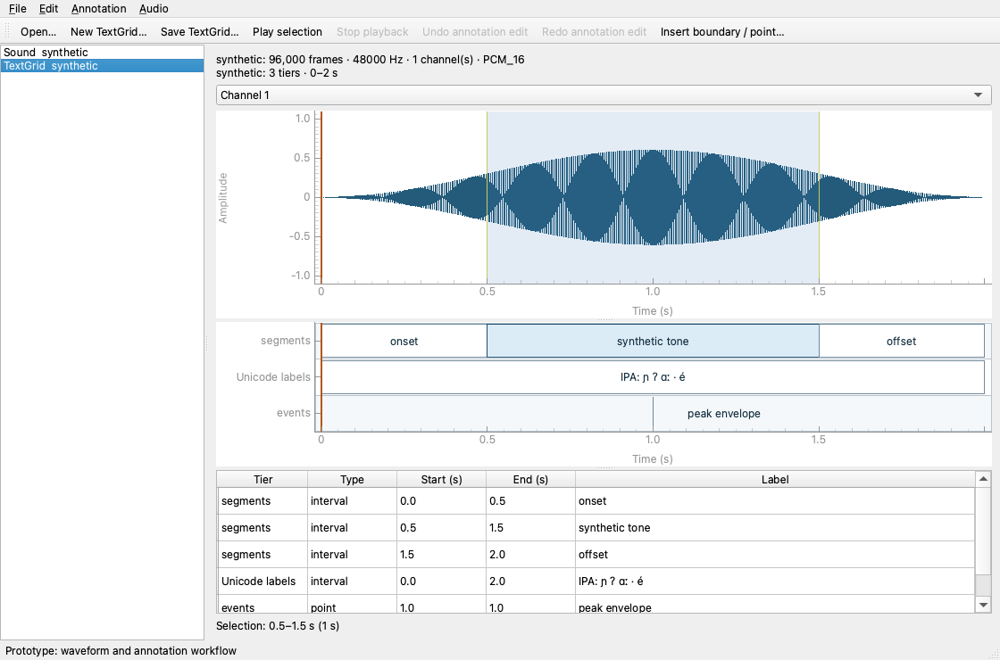

# Praat workflow prototype

Independent Python implementation following [the master specification](REIMPLEMENTATION.md).
This milestone supports WAV inspection/waveforms and TextGrid editing/interchange. It is
not the complete R1 application and has not been validated against a pinned Praat runtime.

## Run

Install [uv](https://docs.astral.sh/uv/) and Python 3.12 or 3.13, then from this directory:

```bash
uv sync --locked --extra gui
uv run langtools-praat gui
```

Open a mono/stereo PCM WAV, select it, and choose **New TextGrid**. Select a TextGrid
to edit its labels in the table; choose an audio object and then the TextGrid to show
both. Audio and annotations keep their own time domains. Drag the shaded waveform
selection or select a table row. Insert a boundary/point, edit labels, undo/redo, and
save a text TextGrid. Use **Play selection** / **Stop playback** to audition the
selected range. Tab toggles playback while a waveform or tier plot has focus;
native label editors keep their own text-navigation keys. Playback preserves all
source channels; the channel dropdown changes the waveform display only.

The graphical tiers share the waveform's time axis. Click an interval/point to
select its table row, and edit its label in the table. Drag an internal boundary
or a point to preview a move; release commits one undoable edit, and Escape
cancels it. Invalid moves are rejected without changing the document. Boundary
merge/delete and multi-tier dragging still await further reference work.




For an original synthetic demo:

```bash
uv run python examples/make_demo.py demo-output
uv run langtools-praat gui demo-output/synthetic.wav demo-output/synthetic.TextGrid
```

Headless use (GUI dependencies are optional):

```bash
uv sync --locked
uv run langtools-praat inspect recording.wav
uv run langtools-praat new-textgrid recording.wav labels.TextGrid --interval-tier words --point-tier events
uv run langtools-praat inspect labels.TextGrid
uv run langtools-praat convert-textgrid labels.TextGrid short.TextGrid --short
uv run langtools-praat set-label labels.TextGrid edited.TextGrid --tier 1 --item 1 --label "ʔaɦɔj"
uv run langtools-praat export-annotations edited.TextGrid labels.csv
```

Outputs are not overwritten unless `--overwrite` is passed. GUI saving asks before
replacement. TextGrid saving is atomic; save failure retains the previous target.

## Develop

```bash
uv sync --locked --extra gui
uv run ruff check .
uv run ruff format --check .
uv run pytest
```

GUI tests use Qt's offscreen platform and an injectable fake audio sink; no
microphone, sound device or reference Praat installation is needed. Real playback
uses sounddevice/PortAudio (included in the `gui` extra; some Linux installations
also need their distribution's `libportaudio2` package). No microphone is opened.
CI runs Python 3.12 on Linux, Windows and macOS,
plus Python 3.13 on Linux. OS/device behavior still needs manual verification.

See [implementation status and ownership](docs/IMPLEMENTATION_STATUS.md),
[interface contracts](docs/INTERFACES.md), and [compatibility limits](docs/COMPATIBILITY.md)
before starting another task. See [playback/tier contracts and limits](docs/PLAYBACK_AND_TIERS.md)
for the next integration. Acoustic analysis remains a separate workstream.
Claim an issue and open a draft PR early.
